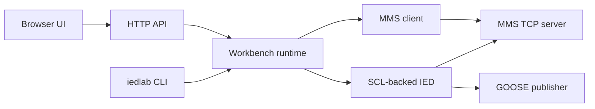

# IEDLab workbench

English | [简体中文](workbench.zh-CN.md)

IEDLab combines the command-line diagnostics and a browser workspace in one Go executable. Its frontend is embedded in the binary and runs offline. Use the current source checkout for this application.

## Start the browser workspace

```sh
go run ./cmd/iedlab serve -http 127.0.0.1:8080
```

Open `http://127.0.0.1:8080`. Click **Load sample**, select **BayIED / S1**, then **Start simulator**. The sample model is shared with the SCD example at [internal/sample/bay.scd](../internal/sample/bay.scd).

1. Choose a listen address such as `127.0.0.1:8102`. Port `0` lets the OS choose an unused port.
2. Keep GOOSE in **Memory** mode for the first run. The workbench encodes Ethernet frames, receives them through a local link and validates them with the GOOSE subscriber.
3. Select `XCBR1.Pos.stVal`. Send **OPEN** or **CLOSE** in the inspector. The browser request creates an MMS association to the simulator, writes the complete Oper structure and displays actual modeled feedback.
4. Enable **Block controls** and repeat the command to see a denied request in the journal.
5. Select `MMXU1.TotW.mag.f`, enter a JSON number, and click **Apply value**. The local acquisition commits the value, current quality and new timestamp together.
6. Click **Connect client**, open the `BayIEDCTRL` domain and read `MMXU1$MX$TotW$mag$f` through TCP. The journal shows the server read.
7. Inspect the **Datasets & GOOSE** tab for ordered FCDA members, APPID, VLAN, timing and ExtRef source bindings.

The left tree filters logical nodes. Search also matches the full object reference or MMS item. **Structures** shows composite types as ordered JSON arrays. The language button switches the main interface between English and Simplified Chinese.

## Import an engineering file

Open **Engineering & reports** after selecting an IED. Choose a primary equipment
path to filter its modeled points, export the point catalog, or check online types
and dataset order against the current MMS connection. RCB cards subscribe to
actual URCB/BRCB instances and request GI. Report entries, inclusion reasons and
EntryID appear in the event journal. BRCB cards accept a hexadecimal resume cursor.
The catalog remains inspectable when a DO is outside the simulation profile.

Use **Import SCL**, drop a file on the page, or preload it at startup.

```sh
go run ./cmd/iedlab serve -file path/to/model.scd
```

The parser accepts SCD, ICD and CID files with the supported SCL profile. Choose the source IED and server access point. The workspace keeps imported documents and independent device instances in memory. Server restart starts a fresh session, so retain the source SCL for the next launch.

Model paths and declared types come from the imported SCL. Static datasets and GSE addresses are resolved by the existing `scl` package. Parse errors and unsupported profiles are displayed to the user. Client-only access points display their GOOSE input declarations.

## Run the simulator from a terminal

```sh
go run ./cmd/iedlab simulate -file internal/sample/bay.scd -ied BayIED -ap S1 -listen 127.0.0.1:8102 -goose memory
go run ./cmd/iedlab inspect -file internal/sample/bay.scd -ied BayIED -ap S1 -match XCBR1.Pos
go run ./cmd/iedlab inspect -file internal/sample/bay.scd -ied StationHMI -ap S1 -inputs
```

`simulate` uses the same runtime as the web interface. It serves the imported model over MMS, registers compatible direct binary controls and runs the configured GOOSE streams. Ctrl+C closes the listener, connections and frame workers. `-controls=false` disables simulated control execution.

For a real Layer 2 publisher, select **Ethernet** in the browser and enter an interface, or use `-goose ethernet -interface <name>` in the CLI. The source MAC comes from that adapter. [Platform support](platforms.md) covers Npcap, Linux raw socket permissions and VLAN behavior.

## Connect to an existing IED

Open **MMS client**, enter an explicit `host:port` and click **Connect**. The selected SCL supplies the peer's ISO selectors when available. Browse the returned domains and names, then select a variable to read its declared type and value.

The remote editor sends a real MMS write. Format its value according to the displayed type. ST/MX updates in the model inspector are local simulation acquisitions. The remote IED enforces its own write permissions.

Integers are represented as decimal JSON strings so INT64 and UINT64 values retain all bits in the browser. Bit strings use `"01"` form, octets use hexadecimal strings, timestamps use RFC3339, and structures/arrays use ordered JSON arrays.

## Find the code while debugging

| File | Breakpoint or customization |
|---|---|
| [cmd/iedlab/app.go](../cmd/iedlab/app.go) | Start the HTTP server or the headless simulator and follow cancellation |
| [internal/workbench/http.go](../internal/workbench/http.go) | HTTP handlers, request limits, same-origin checks and SSE event streaming |
| [internal/workbench/manager.go](../internal/workbench/manager.go) | SCL import, model selection, attribute snapshots and local acquisition |
| [internal/workbench/simulation.go](../internal/workbench/simulation.go) | `Start`, `bindControls` and `Operate` follow server startup, actuator feedback and a TCP control request |
| [internal/workbench/client.go](../internal/workbench/client.go) | Remote MMS associations, browsing, typed reads and writes |
| [internal/workbench/value.go](../internal/workbench/value.go) | JSON ↔ MMS conversion without losing integer precision |
| [internal/workbench/web/app.js](../internal/workbench/web/app.js) | `api`, `selectDevice`, `savePoint` and `operate` follow the browser interaction |
| [examples/scd/breaker/process.go](../examples/scd/breaker/process.go) | A driver interface for integrating actual acquisition, interlocks and actuator results |

`bindControls` is the workbench's virtual actuator. It accepts modeled immediate SPC/DPC controls through `OnControl`, checks the session interlock and updates matching ST feedback. Integrate hardware through public `scl.IED.OnControl` and `Update`; `OnOperate` remains available for direct-normal binary controls. Keep physical feedback independent of command acceptance. [SCL API and common paths](api/scl.md)



## HTTP integration

The API uses JSON except for raw SCL uploads. Successful responses contain the resource. Errors use `{"error":"message"}`.

| Endpoint | Operation |
|---|---|
| `POST /api/models` | Raw SCL bytes, optional URL-encoded `X-File-Name` header, maximum 16 MiB |
| `POST /api/models/sample` / `GET /api/state` | Load the sample / inspect documents, devices, connections and the journal |
| `POST /api/devices` | Select `{"Model":"id","IED":"BayIED","AP":"S1"}` |
| `GET /api/devices/{id}` | Point values, types, datasets, streams and controls |
| `POST /api/devices/{id}/values` | Commit `{"Reference":"…","FC":"MX","Value":42}` |
| `POST /api/devices/{id}/simulation` | Start with `{"listen":"127.0.0.1:8102","goose":"memory","controls":true}` |
| `DELETE /api/devices/{id}/simulation` | Stop the IED and release its resources |
| `POST /api/devices/{id}/operate` | Send `{"Reference":"…Pos.Oper","Value":true}` through MMS |
| `POST /api/devices/{id}/interlock` | Set `{"Blocked":true}` |
| `POST /api/connections` | Connect `{"Address":"host:port","Device":"optional model instance id"}` |
| `GET /api/connections/{id}/domains` / `names?domain=…` / `value?domain=…&item=…` | Browse and read a remote peer |
| `POST /api/connections/{id}/value` | Write `{"Domain":"…","Item":"…","Value":42}` |
| `GET /api/events` | Bounded event journal updates through Server-Sent Events |
| `GET /api/models/{id}/project` | Inspect SubNetworks, ServerAt, equipment and supported semantic diagnostics |
| `POST /api/models/compare` | Compare `{"Before":"model id","After":"model id","IED":"BayIED","AP":"S1"}` |
| `GET /api/models/{id}/inputs?ied=BayIED&ap=S1` | Inspect scoped ExtRef declarations (including client-only access points) |
| `GET /api/connections/{id}/discover?domain=optional-LD` | Discover online types, datasets, RCBs and SGCBs without SCL |
| `POST /api/connections/{id}/reports` | Subscribe using `{"Domain":"BayIEDCTRL","Item":"LLN0$BR$history01","Options":{"Buffer":64,"GI":false}}` |
| `DELETE /api/connections/{id}/reports?domain=BayIEDCTRL&item=LLN0%24BR%24history01` | Stop that block's subscription |
| `POST /api/connections/{id}/snapshot` | Confirmed current dataset read: `{"Domain":"BayIEDCTRL","Item":"LLN0$dsEvents"}`; values are appended to report-history with source `confirmed-read` |
| `GET /api/connections/{id}/report-history?after=0` | Fetch the bounded structured history; `after` is the local record index, not a BRCB EntryID |
| `POST /api/connections/{id}/controls` | `{"Reference":"BayIEDCTRL/XCBR1.Pos","Action":"operate","Value":true,"Options":{"InterlockCheck":true}}`; Action also accepts `select` or `cancel` |
| `GET /api/connections/{id}/settings?domain=BayIEDCTRL` | Read NumOfSG/ActSG/EditSG from the selected domain |
| `POST /api/connections/{id}/settings` | Edit/confirm with `{"Domain":"BayIEDCTRL","Group":2,"Values":{"PTOC1.StrVal.setMag.f":12},"Activate":false}` or activate an existing group with `ActivateOnly:true` and no Values |

Control and setting operations preserve partial protocol evidence in a normal JSON reply: inspect both `result` and `error`, even for HTTP 200. `Acknowledged` is not physical feedback. When operating a saved selection, the selected value/options are reused. Paths and datasets above are examples; discover or inspect the actual target before submitting.

For buffered resume, `Options.ResumeEntryID` is a JSON base64 byte string (`"AAAAAAAAAAA="` requests retained history from the beginning). The browser accepts hexadecimal and converts it. Do not combine ResumeEntryID with PurgeBuffer. History contains the latest 500 records per live connection and is lost when that connection/workbench is closed. `Oldest`, `Last` and `gap` describe local history retention; they are separate from the server's report EntryID/sequence. Current reads add history records but never advance a BRCB cursor.


## Build and advanced diagnostics

```sh
go build -o _local/bin/iedlab ./cmd/iedlab
go run ./cmd/iedlab protocol goose-publisher -output-frame _local/frames/goose.bin
go run ./cmd/iedlab protocol goose-subscriber -input-frame _local/frames/goose.bin
```

The build scripts also produce the single `iedlab` executable. The former six protocol commands are grouped under `iedlab protocol`, retaining their diagnostic flags. `scdinspect` becomes `iedlab inspect`. Individual library examples continue to demonstrate focused API calls.

The transport lifecycle is implemented in the public [simulator package](../simulator/runtime.go); client-side control uses the public [ied package](api/ied.md). Other programs can import them without importing `internal/workbench`.

Use **Station sample → Start station** to start multi-IED GOOSE/SV buses isolated by SubNetwork. The live input panel shows ExtRef values. MU sources publish current editable model values, unsynchronized; application calculations are explicit. CLI: `iedlab simulate -station -file station.scd`. See [station orchestration](api/engineering.md#run-the-complete-station).

## Online services and engineering networks

In MMS client, connect to an IED, select the connection and choose Discover
services. This works without an SCL file. Report cards support subscribe/GI,
explicit resume, stop and a separate current read. The structured report panel
shows source, EntryID, sequence, segments, gaps and typed values. Export JSON
retains this bounded session history (latest 500 records); it is process-local.
The control panel exposes select, operate and cancel and preserves acceptance
and termination results. The settings panel reads groups, edits/confirms SE
values and explicitly activates an existing group.

Engineering & reports shows SubNetworks and ServerAt physical ports. Import
another revision and compare the selected IED/AP. Dataset and input information
retains receiver scope. Station cards show q, smpSynch, receive time, network,
validity and timeout state. Protocol sources and calculations use public SDK APIs.
