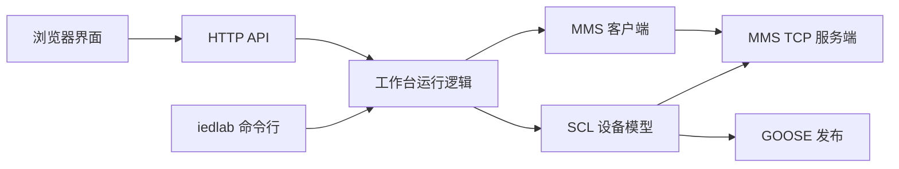

# IEDLab 调试工作台

选定 IED 后打开“工程选点与报告”。一次设备路径可以筛选关联测点，可导出点表或与当前 MMS 连接核对类型和数据集顺序。报告卡片通过真实 MMS 订阅 URCB/BRCB 并总召，日志显示成员、包含原因和 EntryID。BRCB 可填写十六进制续传游标。运行时不支持的 DO 会显示诊断，工程目录仍可查看。

[English](workbench.md) | 简体中文

IEDLab 将命令行调试和浏览器工作台整合为一个 Go 程序。前端静态文件嵌入可执行文件，支持离线使用。应用从当前源码工作树运行。

## 先跑一个完整流程

```sh
go run ./cmd/iedlab serve -http 127.0.0.1:8080
```

打开 `http://127.0.0.1:8080`，点击 **Load sample / 载入示例**，选择 **BayIED / S1**，再点击 **Start simulator / 启动模拟设备**。示例模型与 SCD 用例共用 [internal/sample/bay.scd](../internal/sample/bay.scd)。

1. 监听地址填写 `127.0.0.1:8102`，也可以用端口 `0` 自动选择空闲端口。
2. 第一次保留 GOOSE **Memory** 模式。工作台实际编码 Ethernet 帧，再经内存链路收包，交给 GOOSE 订阅状态机验证。
3. 选中 `XCBR1.Pos.stVal`，在右侧点击 **OPEN / CLOSE**。网页操作会建立到模拟服务端的 MMS 连接，发送完整 Oper，再显示模型反馈。
4. 勾选 **Block controls / 闭锁控制** 后再执行，查看日志里的拒绝原因。
5. 选择 `MMXU1.TotW.mag.f`，填入 JSON 数字，点击 **Apply value / 应用采集值**。值、现有品质和新时标在同一批采集中生效。
6. 点击 **Connect client / 连接 MMS 客户端**，展开 `BayIEDCTRL` 域，选择 `MMXU1$MX$TotW$mag$f`。这次读值通过实际 TCP 请求完成，日志会显示服务端访问。
7. 在 **Datasets & GOOSE** 页查看 FCDA 顺序、APPID、VLAN、重传时间和 ExtRef 输入绑定。

左侧逻辑节点树可过滤点表，搜索框同时匹配对象引用和 MMS item。勾选 **Structures** 可以查看结构，结构按有序 JSON 数组编辑。右上角语言按钮切换主要界面的中英文。

## 导入自己的工程文件

点击 **导入 SCL**，将文件拖入页面，或在启动时预载。

```sh
go run ./cmd/iedlab serve -file path/to/model.scd
```

解析器按已实现的 SCL 范围接受 SCD、ICD、CID 文件。选中源 IED 和服务端 AP 后即可浏览。导入文档和独立设备实例保存在进程内，重启后需要重新导入或使用启动参数预载。

点名、声明类型、静态数据集和 GSE 地址由现有 `scl` 包解析。文件错误及超出支持范围的配置会直接显示原因。纯客户端 AP 可查看它声明的 GOOSE 输入。

## 只用命令行运行

```sh
go run ./cmd/iedlab simulate -file internal/sample/bay.scd -ied BayIED -ap S1 -listen 127.0.0.1:8102 -goose memory
go run ./cmd/iedlab inspect -file internal/sample/bay.scd -ied BayIED -ap S1 -match XCBR1.Pos
go run ./cmd/iedlab inspect -file internal/sample/bay.scd -ied StationHMI -ap S1 -inputs
```

`simulate` 与网页复用同一套运行逻辑，提供 MMS 模型服务、兼容的直接二进制控制及 GOOSE 发布。按 Ctrl+C 会关闭监听端口、连接和帧处理任务。`-controls=false` 可禁用模拟控制执行。

接真实二层网络时，在网页中选择 **Ethernet** 并指定网卡，或给命令行传 `-goose ethernet -interface <网卡>`。源 MAC 来自实际适配器。Npcap、Linux raw socket 权限和 VLAN 行为见[平台说明](platforms.zh-CN.md)。

## 连接现有 IED

打开 **MMS 客户端**，输入明确的 `host:port` 后连接。如果选中了 SCL 模型，将采用模型中的对端 ISO 选择子。展开设备实际返回的 Domain 和对象名，选中变量可读取声明类型与当前值。

远端编辑框会发送实际 MMS Write。按显示的类型填写数据，最终权限由对端设备检查。模型检查器中的 ST/MX 编辑用于本地模拟采集。

整数用十进制 JSON 字符串保留 INT64/UINT64 精度，位串使用 `"01"`，字节串使用十六进制字符串，时间使用 RFC3339，结构和数组使用有序 JSON 数组。

## 学习和调试时看哪里

| 代码 | 断点或自定义入口 |
|---|---|
| [cmd/iedlab/app.go](../cmd/iedlab/app.go) | 网页服务与无界面模拟器的启动、取消和退出 |
| [internal/workbench/http.go](../internal/workbench/http.go) | HTTP 请求、边界检查、同源策略、SSE 日志流 |
| [internal/workbench/manager.go](../internal/workbench/manager.go) | SCL 导入、选择模型、读取快照、提交本地采集 |
| [internal/workbench/simulation.go](../internal/workbench/simulation.go) | `Start`、`bindControls`、`Operate` 分别跟踪服务启动、执行反馈、实际 TCP 控制 |
| [internal/workbench/client.go](../internal/workbench/client.go) | 对端连接、目录、声明类型、读写 |
| [internal/workbench/value.go](../internal/workbench/value.go) | JSON 与 MMS 值的转换、整数精度和类型检查 |
| [internal/workbench/web/app.js](../internal/workbench/web/app.js) | 在 `api`、`selectDevice`、`savePoint`、`operate` 里跟踪网页交互 |
| [examples/scd/breaker/process.go](../examples/scd/breaker/process.go) | 把采集、闭锁和执行结果接到真实设备驱动的接口 |

`bindControls` 是工作台的虚拟执行器，通过 OnControl 处理已建模的 SPC/DPC 控制，先检查会话闭锁，再更新匹配的 ST 反馈。接硬件时用 OnControl 或普通直控接口 OnOperate 绑定驱动，用 Update 上送独立反馈。[SCD API 与常用路径](api/scl.zh-CN.md)



## HTTP 调用入口

除原始 SCL 上传外使用 JSON。成功返回资源，错误格式为 `{"error":"具体原因"}`。

| 路径 | 用法 |
|---|---|
| `POST /api/models` | 上传 SCL 正文字节，可带 URL 编码的 `X-File-Name` 请求头，最大 16 MiB |
| `POST /api/models/sample` / `GET /api/state` | 载入示例 / 查询文档、实例、连接与日志 |
| `POST /api/devices` | 选择 `{"Model":"id","IED":"BayIED","AP":"S1"}` |
| `GET /api/devices/{id}` | 查询点值、类型、数据集、流和控制 |
| `POST /api/devices/{id}/values` | 提交 `{"Reference":"…","FC":"MX","Value":42}` |
| `POST /api/devices/{id}/simulation` | 用 `{"listen":"127.0.0.1:8102","goose":"memory","controls":true}` 启动 |
| `DELETE /api/devices/{id}/simulation` | 停止 IED 并释放资源 |
| `POST /api/devices/{id}/operate` | 通过 MMS 执行 `{"Reference":"…Pos.Oper","Value":true}` |
| `POST /api/devices/{id}/interlock` | 设置 `{"Blocked":true}` |
| `POST /api/connections` | 连接 `{"Address":"host:port","Device":"可选模型实例 id"}` |
| `GET /api/connections/{id}/domains`、`names?domain=…`、`value?domain=…&item=…` | 远端目录和读值 |
| `POST /api/connections/{id}/value` | 写入 `{"Domain":"…","Item":"…","Value":42}` |
| `GET /api/events` | 通过 SSE 接收有界事件日志 |

## 构建和底层诊断

```sh
go build -o _local/bin/iedlab ./cmd/iedlab
go run ./cmd/iedlab protocol goose-publisher -output-frame _local/frames/goose.bin
go run ./cmd/iedlab protocol goose-subscriber -input-frame _local/frames/goose.bin
```

构建脚本现在输出一个 `iedlab` 程序。原来的六个协议命令统一归入 `iedlab protocol`，保留诊断参数。`scdinspect` 合并为 `iedlab inspect`。独立 API 示例继续供学习库调用。

协议生命周期已移入公开的 [simulator 包](../simulator/runtime.go)，客户端控制使用公开的 [ied 包](api/ied.zh-CN.md)。其他程序可以直接导入，无需引用 `internal/workbench`。

点击“整站示例 → 启动整站”，多个 IED 会共享 GOOSE/SV 软件总线，输入面板显示 ExtRef 值。MU 默认发布可编辑的当前模型值，声明为未同步；设备计算逻辑需显式实现。CLI：`iedlab simulate -station -file station.scd`。参见[整站接入](api/engineering.zh-CN.md)。
